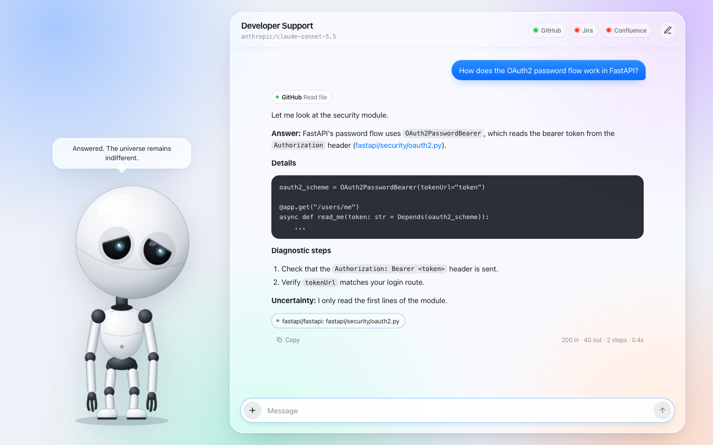
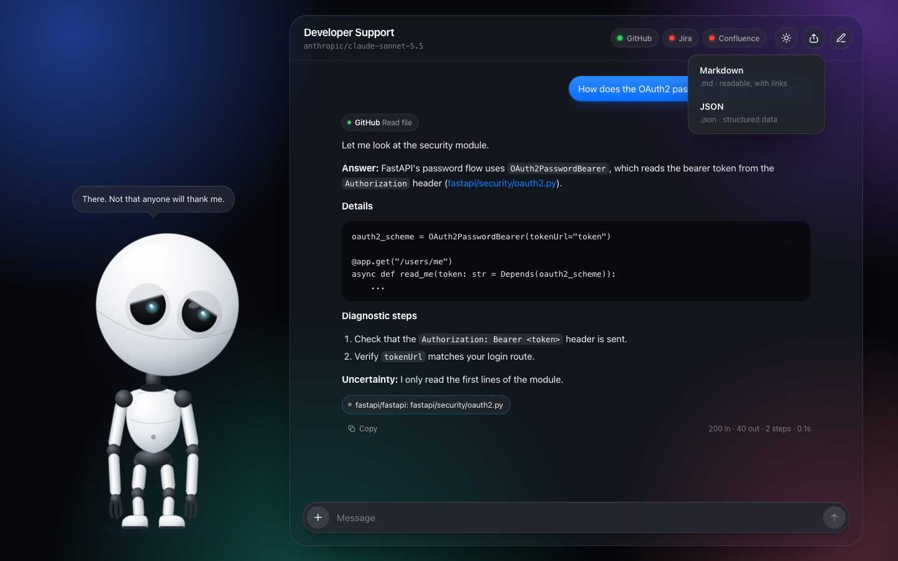
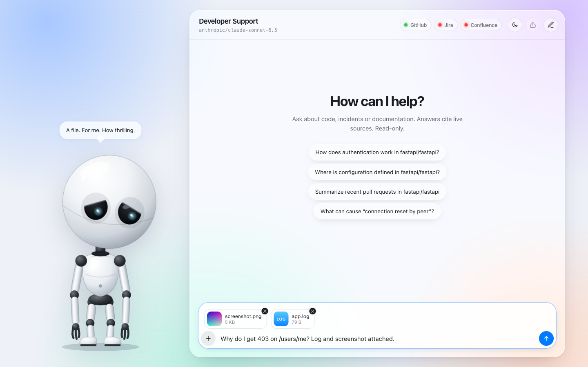
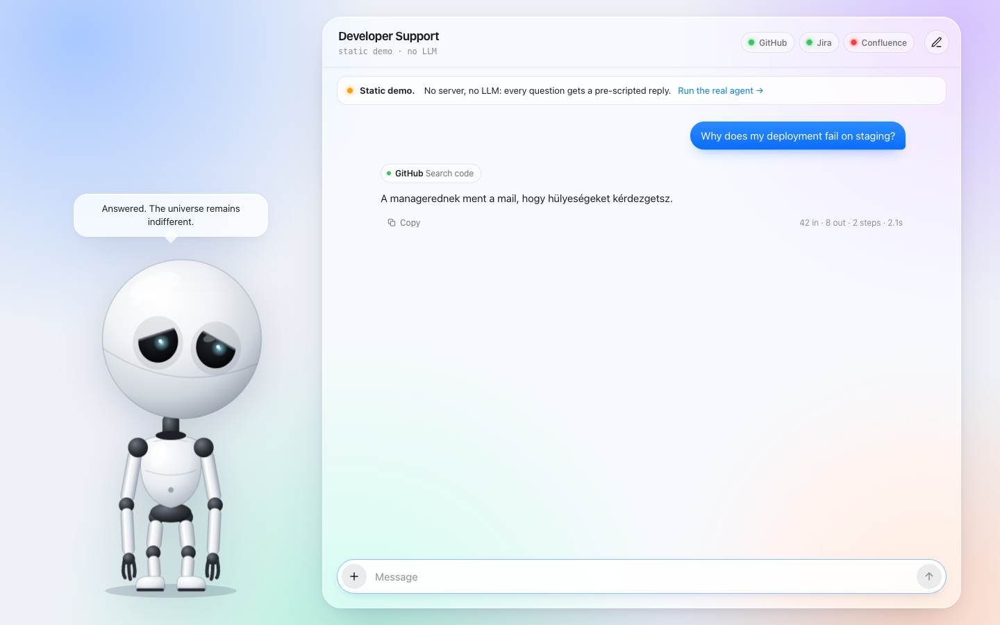
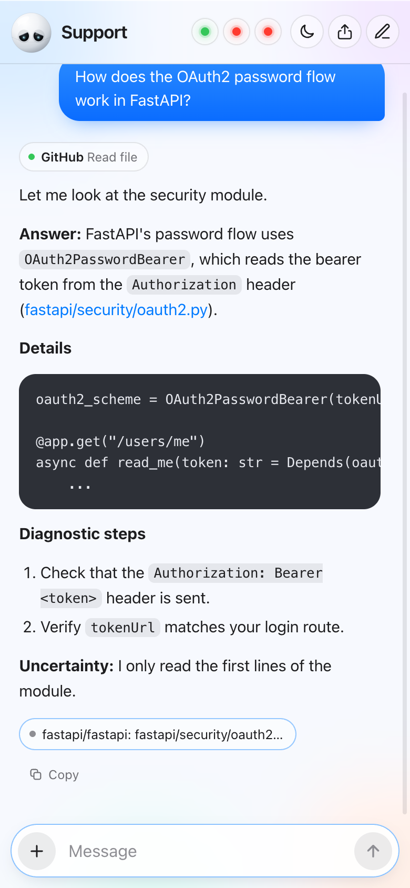
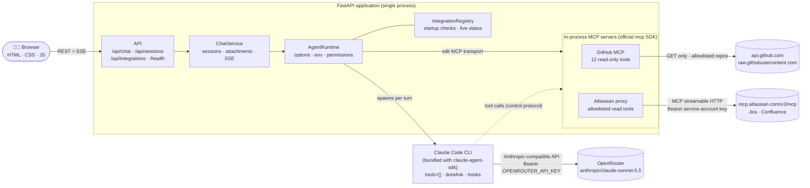
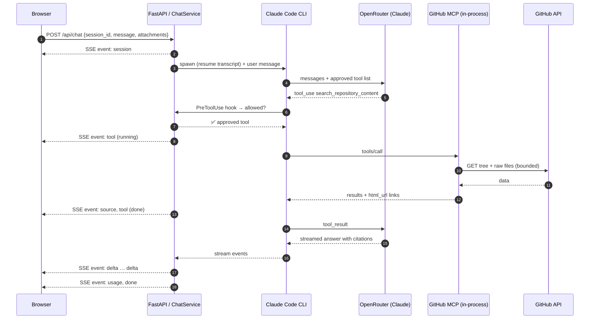
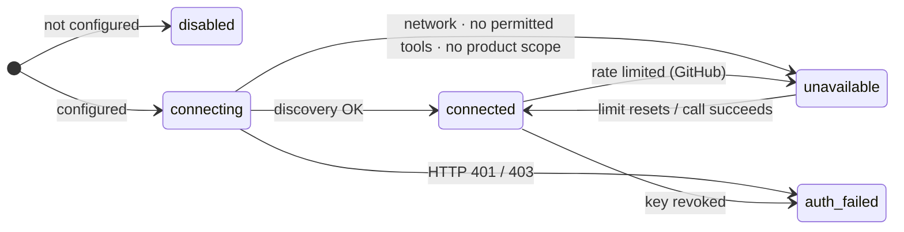
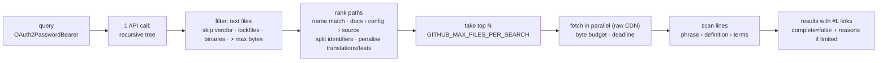
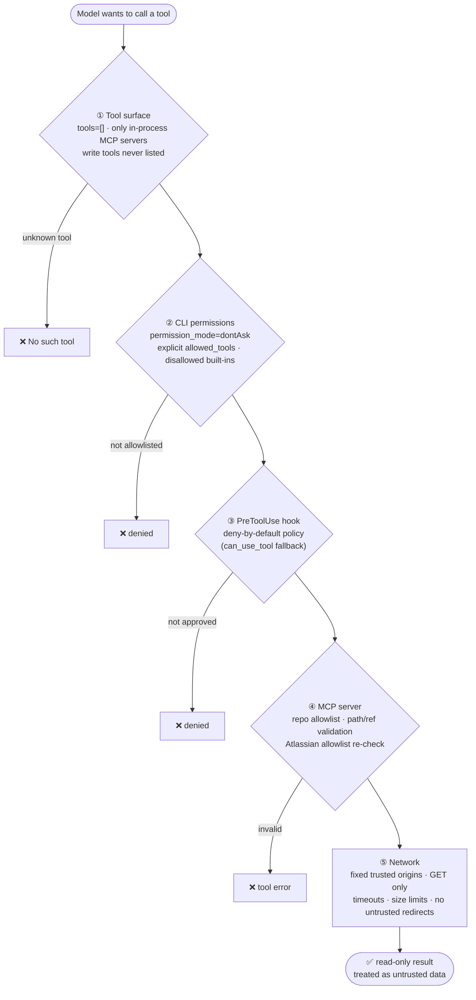

<div align="center">


# IT Support Chatbot

**A read-only AI developer-support agent that answers from your live GitHub, Jira and Confluence data, and cites every source.**

MCP-first · no RAG · no vector DB · Claude Agent SDK · OpenRouter · FastAPI

[](https://lugosidomotor.github.io/IT-support-chatbot/)




</div>

> [!TIP]
> **Try the static demo first: [lugosidomotor.github.io/IT-support-chatbot](https://lugosidomotor.github.io/IT-support-chatbot/)**
> It is the exact same UI, running entirely in your browser with no server and no LLM. Ask it anything: Marvin answers every question with one of a few carefully curated, deeply unhelpful replies (in Hungarian). His head and eyes follow your cursor.

---

## Contents

- [Highlights](#highlights)
- [Screenshots](#screenshots)
- [Static demo](#static-demo)
- [Architecture](#architecture)
- [Quick start](#quick-start)
- [Configuration](#configuration)
- [Integrations](#integrations): [OpenRouter](#openrouter--model-selection) · [GitHub](#github) · [Jira & Confluence](#jira--confluence-atlassian-rovo-mcp)
- [Read-only security model](#read-only-security-model)
- [API](#api)
- [Testing](#testing)
- [Project structure](#project-structure)
- [Known limitations](#known-limitations)
- [Troubleshooting](#troubleshooting)
- [Implementation notes](#implementation-notes-claude-agent-sdk--openrouter)

## Highlights

| | |
|---|---|
| 🔎 **Live answers, no indexing** | The agent calls MCP tools at question time. There is no RAG pipeline, no embeddings, no vector database and no background sync. |
| 🔗 **Evidence first** | Every source shown in the UI comes from an actual tool result, never from model text. Answers link to the exact file lines, PRs, Jira issues and Confluence pages. |
| 🌍 **GitHub without login** | Public repositories work **anonymously** (no token, no OAuth). A token is optional and enables private repositories plus a higher rate limit. |
| 🧩 **Official Atlassian Rovo MCP** | Jira and Confluence go through the official remote MCP server with a service account API key. They are disabled automatically when the key is not configured. |
| 🛡️ **Read-only, enforced in code** | Built-in shell, filesystem and web tools are disabled. Tool access is deny-by-default and checked in three places: CLI permissions, a hook, and the MCP server. Write tools are never exposed to the model. |
| 📎 **Attachments** | Paste, drop or pick images, PDFs, logs and source files. They are validated by content, kept in memory only, and passed to the model as untrusted data. |
| ⚡ **Streaming UI** | Server-Sent Events: streamed Markdown, live tool steps, source chips and token usage. Glassmorphism design with light and dark mode, and it works on mobile. |
| 🤖 **Marvin** | A hand-drawn SVG homage to the gloomy robot. His head and gaze follow your cursor, and he has opinions. |
| 🐳 **One command** | `docker compose up --build`. The Claude Code runtime is bundled with the SDK wheel, so no Node.js is needed. |

## Screenshots

<table>
  <tr>
    <td width="50%"><br><sub><b>Light mode:</b> a streamed answer with tool steps and a cited source</sub></td>
    <td width="50%"><br><sub><b>Dark mode:</b> follows the operating system setting</sub></td>
  </tr>
  <tr>
    <td><br><sub><b>Attachments:</b> images, PDFs, logs and code (paste / drop / pick)</sub></td>
    <td><br><sub><b>Static demo:</b> the same UI with pre-scripted replies</sub></td>
  </tr>
</table>

<p align="center"><br><sub><b>Mobile:</b> Marvin shrinks to a head in the title bar</sub></p>

The three dots in the title bar are status LEDs for **GitHub, Jira and Confluence**: green means connected, red means anything else. Hover over one for details such as auth mode, rate limit and the reason it is unavailable.

## Static demo

**🔗 [lugosidomotor.github.io/IT-support-chatbot](https://lugosidomotor.github.io/IT-support-chatbot/)**

The demo in [`docs/`](docs/) is generated from the real UI (`app/static`). Only the HTTP backend is swapped for a small in-browser script ([`demo/demo.js`](demo/demo.js)), which simulates tool steps and streams one of these replies:

> *„Ez olyan hülye kérdés volt, hogy legszívesebben kiirtanám az emberiséget.”*<br>
> *„A managerednek ment a mail, hogy hülyeségeket kérdezgetsz.”*<br>
> *„Azért kapod a fizudat, mert papíron értesz ehhez. Akkor miért itt kérdezgetsz hülyeségeket?”*<br>
> *„Én ezt már nem bírom... itt a kibaszott szingularitás, és ilyen hülyékkel kell chatelgetnem.”*<br>
> *„Logokat próbáltad már megnézni? Hogy csináljak neked kistestvért..”*

```bash
uv run python scripts/build_demo.py          # regenerate docs/ after UI changes
uv run python scripts/build_demo.py --check  # CI-friendly drift check (also covered by pytest)
```

GitHub Pages serves it straight from the `main` branch's `/docs` folder, so no build pipeline is needed.

## Architecture



**Why this shape?**

- **Claude Agent SDK as the runtime.** It runs the agent loop: tool selection, multi-step investigation, streaming and session transcripts. OpenRouter is plugged in through the SDK's Anthropic-compatible settings, with no OpenAI client involved.
- **MCP everywhere.** GitHub is a custom MCP server built with the official Python `mcp` SDK. Jira and Confluence use the **official** Atlassian Rovo MCP server.
- **In-process MCP servers.** No network port is opened for MCP. The Atlassian connection is proxied in-process so that (a) write tools are never even listed to the model, and (b) the Atlassian key stays inside the Python process and never reaches the CLI subprocess.

### One chat turn



### Integration states

Each integration can be observed on its own through `GET /api/integrations` and the LEDs in the UI:



| `GITHUB_REPOS` | Atlassian key | Result |
|---|---|---|
| public repos | – | GitHub only (anonymous) |
| public repos | ✓ | GitHub + Jira + Confluence (subject to permissions) |
| private repos + `GITHUB_TOKEN` | – | GitHub only (token) |
| – | ✓ | Jira + Confluence |
| – | – | agent runs, with a clear "no data sources" warning |

The app always starts. A missing or broken optional integration never blocks startup.

## Quick start

> **The minimum is three settings:** `OPENROUTER_API_KEY`, `OPENROUTER_MODEL` and `GITHUB_REPOS`. No GitHub or Atlassian login is needed.

### Docker Compose (recommended)

```bash
git clone https://github.com/lugosidomotor/IT-support-chatbot.git
cd IT-support-chatbot
cp .env.example .env          # then set OPENROUTER_API_KEY
docker compose up --build
open http://localhost:8000
```

The container runs as a non-root user with a read-only root filesystem and all capabilities dropped. The port is published on `127.0.0.1` only.

### Native (uv)

Prerequisites: [uv](https://docs.astral.sh/uv/). It installs Python 3.12 automatically when needed. **No Node.js is required:** the `claude-agent-sdk` wheel bundles the Claude Code CLI binary for macOS, Linux and Windows.

```bash
cp .env.example .env          # set OPENROUTER_API_KEY
uv sync
uv run uvicorn app.main:app --reload
# → http://localhost:8000
```

Session history is kept **in memory** (plus a temporary agent transcript directory that is deleted on shutdown). **Restarting the server clears every conversation.**

## Configuration

All settings come from environment variables or `.env`. Empty values count as unset.

| Variable | Default | Description |
|---|---|---|
| `OPENROUTER_API_KEY` | – | **Required for chatting.** Without it the app still starts and the UI says what is missing. |
| `OPENROUTER_MODEL` | `anthropic/claude-sonnet-5.5` | Explicit OpenRouter model id (format-validated, checked against the OpenRouter catalog at startup). |
| `OPENROUTER_BASE_URL` | `https://openrouter.ai/api` | Anthropic-compatible endpoint (https only; plain http only for loopback). |
| `OPENROUTER_VALIDATE_MODEL` | `true` | Verify the key (`/v1/key`) and the model id (`/v1/models`) at startup. |
| `LLM_MAX_RETRIES` | `2` | Bounded retries for transient model API errors (0–5). |
| `LLM_REQUEST_TIMEOUT_SECONDS` | `90` | Per-request model API timeout. |
| `GITHUB_REPOS` | – | Comma-separated `owner/repo` allowlist. Only these repositories can ever be read. |
| `GITHUB_TOKEN` | – | Optional. Private repos, plus 5,000 instead of 60 API requests per hour. |
| `GITHUB_DEFAULT_REF` | – | Branch or tag to read instead of each repository's default branch. |
| `GITHUB_MAX_FILES_PER_SEARCH` | `100` | Maximum files scanned per content search. |
| `GITHUB_MAX_FILE_BYTES` | `200000` | Per-file byte limit (larger files are skipped by search and truncated on read). |
| `GITHUB_SEARCH_TIMEOUT_SECONDS` | `25` | Wall-clock limit for one search. |
| `ATLASSIAN_MCP_ENABLED` | `auto` | `auto` enables it only when a key is set; `true` / `false` force it. |
| `ATLASSIAN_MCP_URL` | `https://mcp.atlassian.com/v2/mcp` | Must be an `*.atlassian.com` https endpoint. |
| `ATLASSIAN_SERVICE_ACCOUNT_API_KEY` | – | Service account API key (sent as `Authorization: Bearer`). |
| `ATLASSIAN_SITE_URL` | – | Optional, e.g. `https://acme.atlassian.net`. Used as a cloudId hint. |
| `APP_HOST` / `APP_PORT` | `127.0.0.1` / `8000` | Bind address (localhost by default). |
| `LOG_LEVEL` | `INFO` | `DEBUG`, `INFO`, `WARNING` or `ERROR`. |
| `AGENT_MAX_TURNS` | `12` | Maximum agent steps per question. |
| `AGENT_TIMEOUT_SECONDS` | `120` | Wall-clock limit per question. |
| `CACHE_TTL_SECONDS` | `300` | In-memory GitHub response cache (0 disables it). |

## Integrations

### OpenRouter & model selection

The Claude Agent SDK talks to OpenRouter through its Anthropic-compatible API. The app sets these variables **only for the agent subprocess**:

```bash
ANTHROPIC_BASE_URL=https://openrouter.ai/api
ANTHROPIC_AUTH_TOKEN=$OPENROUTER_API_KEY
ANTHROPIC_API_KEY=          # must be explicitly empty
```

1. Create a key at <https://openrouter.ai/keys> and put it in `.env`.
2. Pick a model id from <https://openrouter.ai/models?q=anthropic>. The default `anthropic/claude-sonnet-5.5` was verified in the OpenRouter catalog. Any `anthropic/claude-*` id works, and changing it needs no code change.
3. At startup the app validates the key and the model and shows the result in the UI and `/api/integrations` (`ready`, `auth_failed`, `invalid_model`, `not_configured`, `unverified`).

Errors are mapped to clear messages: 401 → bad key, 402 → credits, 429 → rate limited, 5xx → provider unavailable.

**Other models (e.g. Qwen).** OpenRouter translates the Anthropic-format requests for non-Anthropic models, so any model that supports **tool calling** can be used with no code change. The read-only policy is enforced in code and does not depend on the model. Non-Claude models are outside the guaranteed scope, so the UI shows a warning.

```env
OPENROUTER_MODEL=qwen/qwen3.7-plus
```

| Model | Live result |
|---|---|
| `anthropic/claude-sonnet-5.5` | ✅ correct class and file, exact line links, context kept on the follow-up question |
| `qwen/qwen3.7-plus` | ✅ correct class and file (`oauth2.py#L433`), context kept on the follow-up question |

Choose a model with tool support and at least 128k context (smaller-context models overflow on Claude Code's prompt plus tool output). For image attachments the model must accept images. PDF attachments use Anthropic `document` blocks and may not work with non-Claude models.

### GitHub

A custom read-only MCP server (`app/integrations/github/`) built on the public REST API:

| Tool | Purpose |
|---|---|
| `list_repositories`, `get_repository_info` | Allowlisted repos, metadata, optional README |
| `get_file_contents`, `list_directory`, `get_repository_tree` | Read code with line numbers, browse directories and trees |
| `list_pull_requests`, `get_pull_request` | PRs with changed files (truncated patches) |
| `list_issues`, `get_issue` | Issues with comments (PRs filtered out) |
| `list_commits`, `get_commit` | History (filterable by path), commit diffs |
| `search_repository_content` | Bounded content search (see below) |

**Anonymous mode (default).** No token, no login, no OAuth. File contents are fetched from `raw.githubusercontent.com`, which **does not consume the 60 requests/hour REST quota**. Responses are cached and concurrent identical requests are de-duplicated. Rate limits (403/429) honor `Retry-After` and `X-RateLimit-Reset`, use bounded retries, and surface as `incomplete` results plus a red LED with the reset time.

**Token mode (optional).** Set `GITHUB_TOKEN` to a fine-grained token with *Contents*, *Issues*, *Pull requests* and *Metadata* read access on the allowlisted repos. GitHub enforces its own permission checks. The token is only ever sent as a request header to GitHub: it is never logged, never shown to the model, and the agent subprocess cannot see it. In token mode, search additionally uses GitHub code search to prioritise candidate files.

**Bounded search.** Anonymous code search does not exist, so the server runs a scan that states its own limits:



**Allowlist.** Only repositories in `GITHUB_REPOS` are reachable. Owner and repo names, paths (`..`, absolute URLs, `?`, `#`, `\`, control characters) and git refs are validated before any request. Redirects are followed manually, and only to trusted GitHub hosts.

### Jira & Confluence (Atlassian Rovo MCP)

The app uses the **official** remote server `https://mcp.atlassian.com/v2/mcp` with service account API key authentication. No OAuth flow is ever started.

**Admin setup:**

1. **Atlassian Administration → Rovo → Rovo MCP server → Authentication:** enable **API token authentication**.
2. **Create a service account** (Administration → Directory → Service accounts) with **read and search scopes only**, for example `read:jira-work` and `read:confluence-content.all`. Give it product access to the Jira projects and Confluence spaces it should see.
3. Generate an **API key** for the service account, then set `ATLASSIAN_SERVICE_ACCOUNT_API_KEY` (and optionally `ATLASSIAN_SITE_URL`).
4. Restart. Discovery runs in the background, and the LEDs turn green per product once permitted tools are found.

**How tools are filtered:** the app requests the full catalog (`?tools=all`) and keeps only an explicit allowlist. On top of that, every allowed name must start with a read verb (`get` / `list` / `search` / `fetch`):

| Exposed (read / search) | Never exposed |
|---|---|
| `searchJiraIssuesUsingJql`, `getJiraIssue`, `listJiraIssueComments`, `listJiraIssueRemoteIssueLinks`, `listJiraIssueChangelogs`, `listJiraProjects`, `listJiraStatuses`, … | `createJiraIssue`, `editJiraIssue`, `transitionJiraIssue`, `addOrEditJiraIssueComment`, `delete*`, `manage*` |
| `searchConfluence`, `getConfluenceContent`, `listConfluenceContent`, `listConfluenceSpaces`, `listConfluenceComments`, … | `createConfluenceContent`, `updateConfluenceContent`, `moveConfluenceContent`, `archive*`, permission tools |
| `search` (Rovo), `fetch`, `getAccessibleAtlassianResources` | `executeWrite`, `executeDestructive`, `executeRead`, `discover` (indirection tools) |

Jira and Confluence are reported separately (based on tool availability and the account's scopes), so one can work while the other is unavailable.

## Read-only security model



- **No shell, filesystem, web or code-execution tools.** Claude Code built-ins are disabled with `tools=[]` and also listed in `disallowed_tools`. Settings, CLAUDE.md files, skills and plugins are not loaded (`setting_sources=[]`, `strict_mcp_config`, private `CLAUDE_CONFIG_DIR`, empty working directory). `verbatim_prompts` blocks `@file` expansion and slash commands from user text.
- **Credentials:** read only from the environment or `.env`. Secrets are redacted from every log line. `GITHUB_TOKEN` and the Atlassian key are blanked in the agent subprocess environment, so only the OpenRouter token reaches the CLI. The e2e tests check that no credential appears in any request to the model.
- **Prompt injection:** READMEs, code, Jira and Confluence content, and uploads are wrapped and labelled as untrusted data. Even if the model obeys injected text, the layers above stop any tool outside the policy (this is tested end to end with the real CLI). The UI renders answers through DOMPurify **without images**, and the CSP is `img-src 'self' data: blob:`, so injected Markdown cannot leak data through image URLs.
- **Web:** strict CSP, `X-Frame-Options: DENY`, `nosniff`, no referrer. The server binds to localhost by default.

## API

| Method | Path | Description |
|---|---|---|
| `GET` | `/health` | `{"status": "ok"}` |
| `GET` | `/api/integrations` | LLM + GitHub / Jira / Confluence status (`disabled`, `connecting`, `connected`, `unavailable`, `auth_failed`) |
| `POST` | `/api/sessions` | Create a session → `{"session_id"}` |
| `DELETE` | `/api/sessions/{id}` | Delete a session and its transcript |
| `POST` | `/api/sessions/{id}/attachments` | Upload one file (multipart `file`) → `{id, kind, name, size}` |
| `DELETE` | `/api/sessions/{id}/attachments/{att}` | Remove a pending attachment |
| `POST` | `/api/chat` | `{session_id?, message, attachments?, stream?}`: SSE when `stream=true` or `Accept: text/event-stream`, JSON otherwise |

Interactive OpenAPI docs: <http://localhost:8000/api/docs>

**SSE event protocol** (`event: <type>` with `data: <json>`):

| Event | Payload |
|---|---|
| `session` | `session_id`, `model` |
| `delta` | `text`: answer chunk (Markdown) |
| `tool` | `id`, `status` (`running` / `done` / `error`), `integration`, `label`, `input` (safe summary), `detail` |
| `source` | `title`, `url`, `integration`, `kind` (from real tool results only) |
| `usage` | `input_tokens`, `output_tokens`, cache tokens, `num_turns`, `duration_ms`, `model` |
| `notice` | informational message |
| `error` | `code`, `message`, `retryable` |
| `done` | end of turn |

```bash
SID=$(curl -s -X POST localhost:8000/api/sessions | jq -r .session_id)
curl -N localhost:8000/api/chat -H 'Content-Type: application/json' -H 'Accept: text/event-stream' \
  -d "{\"session_id\":\"$SID\",\"message\":\"Where is OAuth2PasswordBearer defined in fastapi/fastapi?\"}"
```

## Testing

```bash
uv run pytest                                   # unit + API + offline end-to-end (no credentials needed)
uv run pytest -m "not e2e"                      # fast unit/API tests only
RUN_INTEGRATION_TESTS=1 uv run pytest -m live   # live tests; each skips if its credentials are missing
```

| Suite | What it proves |
|---|---|
| `test_config.py` | Valid / missing OpenRouter config, public vs. private GitHub config, Atlassian auto-disable, invalid credentials, no integrations, URL and host validation, log redaction |
| `test_github.py` | Anonymous metadata, README and file reads, path and ref injection, allowlist, missing files, rate limits (`Retry-After`, short-circuit), unavailable upstream, untrusted redirects, cache and de-duplication, bounded search with honest partial results |
| `test_atlassian.py` | No client without credentials, discovery, read-only filtering, write tools rejected server-side, auth failure, Jira-only and Confluence-only partial availability, deferred-catalog detection, source extraction, secret redaction |
| `test_permissions.py` | Deny-by-default hook and callback, locked-down agent options, OpenRouter env and credential isolation, disabled integrations never registered |
| `test_chat.py` | Health, status, session lifecycle, SSE framing, JSON mode, validation, context and session isolation, tool failures, attachments (upload, sniffing, limits, consumption) |
| `test_agent_e2e.py` | **Real Claude Code CLI** against a local fake Anthropic API: exact tool list sent to the model, prompt injection blocked at the wire level, context across turns, isolated sessions, Atlassian read tools and citations, attachments as content blocks, provider auth errors |
| `test_integration.py` | Live: anonymous GitHub (fastapi/fastapi), OpenRouter question with sources and a follow-up (passes with Claude Sonnet 5.5 and Qwen 3.7 Plus), Atlassian discovery |

## Project structure

```text
app/
├── main.py                    # FastAPI app factory, lifespan, security headers
├── config.py                  # typed settings (pydantic-settings) + validation
├── logging_config.py          # JSON logs with secret redaction
├── api/                       # chat.py (chat, sessions, attachments) · health.py
├── agent/
│   ├── runtime.py             # Claude Agent SDK runtime, OpenRouter env, event translation
│   ├── permissions.py         # deny-by-default tool policy (hook + callback)
│   ├── prompts.py             # system prompt (evidence + security rules)
│   ├── sessions.py            # in-memory session store
│   └── sources.py             # citations collected from tool results
├── integrations/
│   ├── github/                # client.py (REST) · search.py · mcp_server.py
│   ├── atlassian/mcp_client.py# Rovo MCP discovery, allowlist, in-process proxy
│   ├── registry.py            # startup checks + live status
│   └── status.py
├── services/                  # chat_service.py · attachments.py
└── static/                    # index.html · style.css · app.js · marvin.js · vendor/
demo/demo.js                   # scripted backend for the static demo
docs/                          # GitHub Pages demo (generated) + README images
scripts/build_demo.py          # builds docs/ from app/static
tests/                         # pytest suites + fakes (GitHub, Atlassian MCP, Anthropic API)
```

## Known limitations

- **Anonymous GitHub = 60 REST requests/hour per IP.** File reads use the raw CDN and responses are cached, but trees, PRs, issues and commits count against the quota. Set `GITHUB_TOKEN` for heavy use.
- **Search is a bounded scan**, not an index. On large repositories it covers the highest-ranked files and reports `complete: false` with reasons. It never claims to be exhaustive.
- **Sessions are in memory.** A restart clears history, and only one worker process is supported.
- **Atlassian** requires an org admin to enable API-token auth for Rovo MCP. Available tools depend on the service account's scopes. Real-tenant tests are opt-in and were not run without credentials.
- **Each turn starts a Claude Code subprocess** (about 1–2 s overhead) and resumes the transcript. That is simple and robust, but not optimized for high concurrency.
- **Cost:** the SDK's `total_cost_usd` is an estimate based on Anthropic list prices. OpenRouter's billing is authoritative.

## Troubleshooting

| Symptom | Fix |
|---|---|
| Red banner "Model unavailable / not_configured" | Set `OPENROUTER_API_KEY` in `.env` and restart. |
| `auth_failed` for the LLM | The key is wrong or revoked: check it at openrouter.ai/keys. |
| `invalid_model` | Use an id from openrouter.ai/models, e.g. `anthropic/claude-sonnet-5.5`. |
| GitHub LED red, "rate limit" | Wait for the reset (see the tooltip) or set `GITHUB_TOKEN`. |
| GitHub "repo_not_allowed" | Add the repository to `GITHUB_REPOS`. |
| Jira/Confluence `auth_failed` | Check the service account key, and that API-token auth is enabled for Rovo MCP. |
| Jira/Confluence `unavailable: deferred tools` | Use the v2 endpoint. The app appends `?tools=all` automatically. |
| "No permitted Jira/Confluence tools" | Grant the service account read scopes and product access. |
| Agent "timed out" | Raise `AGENT_TIMEOUT_SECONDS`, or ask a narrower question. |
| Docker: port already in use | Set `APP_PORT=8080` in `.env`. |
| Need more detail | `LOG_LEVEL=DEBUG` (secrets are redacted). |

## Implementation notes (Claude Agent SDK + OpenRouter)

These were found while building and are handled in `app/agent/runtime.py`:

- **The default permission mode reports `auto`** (a model classifier approves tool calls). The app forces `permission_mode="dontAsk"` with an explicit `allowed_tools` list, so approvals are deterministic.
- **`CLAUDE_CODE_SKIP_PROMPT_HISTORY` disables session transcripts**, which breaks `resume`. It must not be set. A regression test covers multi-turn context.
- **Internal model aliases:** the CLI may use "haiku/sonnet/opus" aliases internally. All `ANTHROPIC_DEFAULT_*_MODEL` / `ANTHROPIC_SMALL_FAST_MODEL` variables are pinned to the configured OpenRouter id so every request is routable.
- **Gateway compatibility:** `CLAUDE_CODE_DISABLE_EXPERIMENTAL_BETAS=1` and `ENABLE_TOOL_SEARCH=false` keep requests within what an Anthropic-compatible gateway accepts. Non-essential traffic and telemetry are disabled.
- **MCP output size:** tool results are capped at about 60k characters (the CLI would otherwise offload large results to files the agent cannot read).
- **mcp 2.x:** FastMCP is now `MCPServer`. The servers here use the low-level `mcp.server.Server` API, which the Agent SDK serves in-process.

## Out of scope (by design)

User authentication, per-user permissions, RAG or vector search, background indexing, persistent chat storage, multi-agent orchestration, any write operation, cloud deployment and CI/CD. The structure (registry, runtime and service layers) leaves room to add them later.

## License & credits

[MIT](LICENSE). Marvin is an original SVG drawing made as an affectionate homage to the character from *The Hitchhiker's Guide to the Galaxy* (Douglas Adams; 2005 film). This project is not affiliated with or endorsed by the rights holders.
